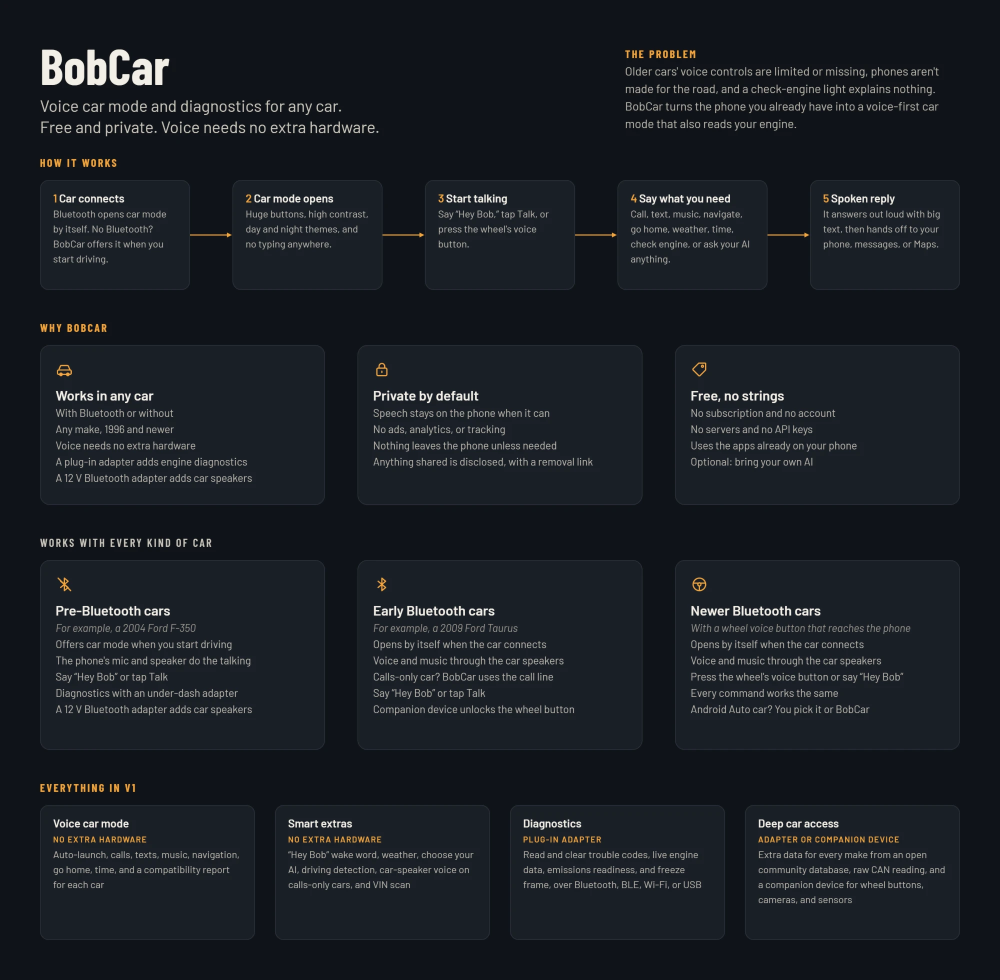

# Pre-hackathon design (not hackathon work)

Everything in this folder existed **before** the Meta Global AI Developer Hackathon. It's the planning material for the app, under its old working name "BobCar". It's kept here so judges can see what came before the event. None of it is code.

| File | What it is |
|---|---|
| [design-guide.md](design-guide.md) | The full build guide: product, architecture, data model, and mechanics (Revision 9, 2026-10-26) |
| [overview.webp](overview.webp) | A one-page product overview |

## Differences in the hackathon build

- **Name:** the app is now called **AnyCar**.
- **Meta models:** the guide's V1 has no network access and no API keys. The hackathon build adds Meta models (see the main [README](../../README.md)).
- **Scope:** the hackathon build covers only part of the guide.
